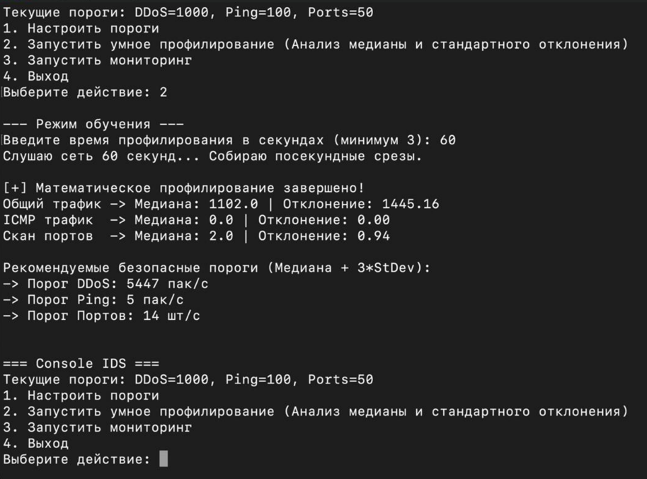
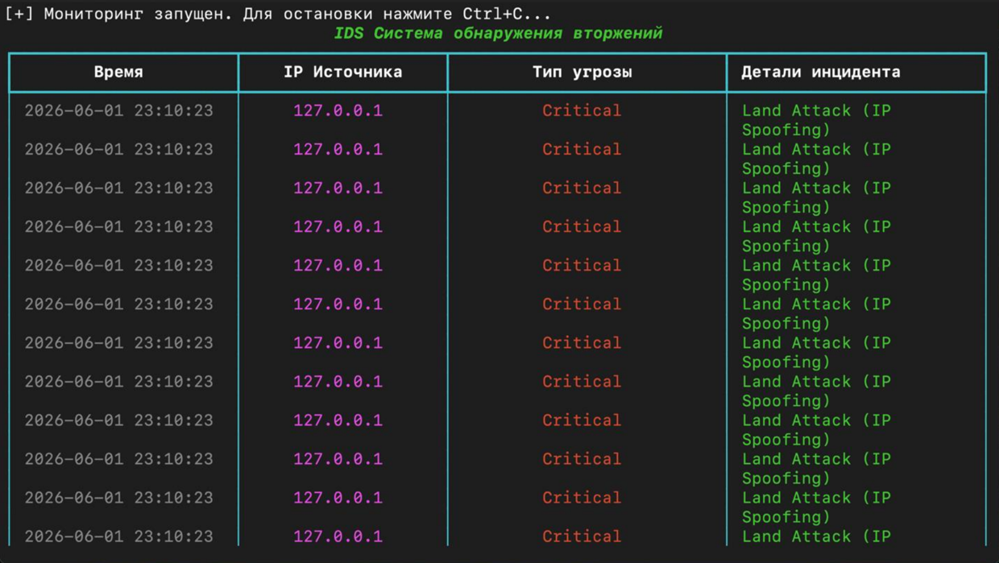
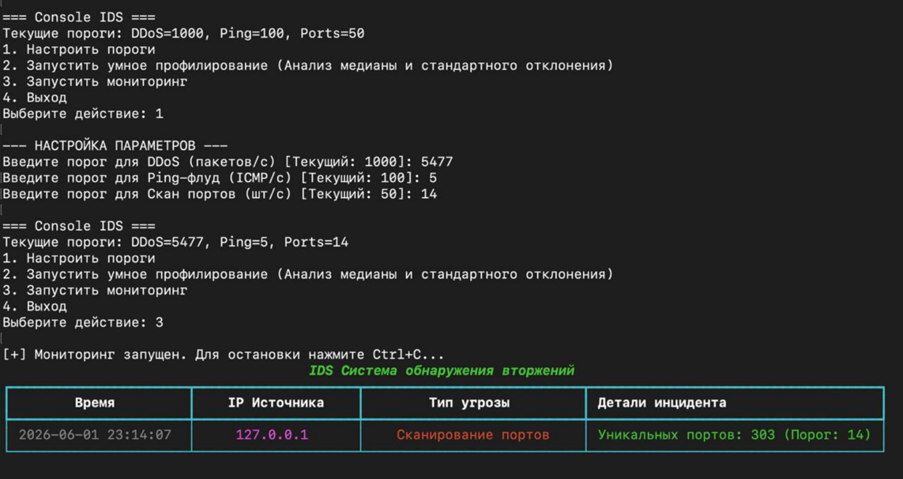
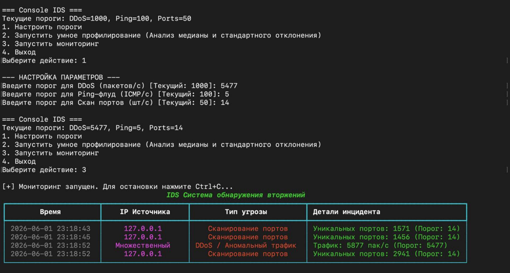

# Console IDS — система обнаружения сетевых вторжений

Консольное Python-приложение для обнаружения атак на рабочую станцию. Сигнатурный анализ известных паттернов вторжений + статистический анализ трафика с автоматическим расчётом порогов аномалий.

Разработано в качестве учебно-исследовательского прототипа в рамках прохождения ознакомительной практики в РТУ МИРЭА. Реализует гибридный подход к IDS (Intrusion Detection System), сочетающий классический сигнатурный метод и адаптивное обнаружение аномалий на основе медианы и стандартного отклонения.

## Возможности

**Сигнатурный анализ (декларативные правила, `signatures.json`):**
- Land Attack (IP-спуфинг, когда IP отправителя = IP получателя)
- Null Scan (TCP-пакет без установленных флагов)
- Xmas Scan (аномальная комбинация флагов FIN/PSH/URG)
- Новые сигнатуры добавляются редактированием JSON-файла, без изменения кода

**Статистический анализ (адаптивные пороги, отдельный процесс):**
- Режим обучения: сбор посекундных метрик трафика (общий поток, ICMP, уникальные порты)
- Расчёт медианы и стандартного отклонения по каждой метрике (модуль `statistics`)
- Автоматическое формирование порога по модифицированному правилу трёх сигм:

  ```
  Threshold = Me + 3σ + Buffer
  ```

  где `Me` — медиана, `σ` — стандартное отклонение, `Buffer` — запас для отсечения ложных срабатываний на микро-всплесках
- Агрегация и проверка порогов выполняются в отдельном процессе (`multiprocessing`), не блокируя перехват пакетов

**Мониторинг и логирование:**
- Динамическая консольная таблица (библиотека `rich`) с историей инцидентов в реальном времени
- Персистентное логирование всех событий в `alerts.csv`
- Дедупликация алертов (cooldown): один и тот же тип угрозы с одного IP не логируется повторно чаще, чем раз в несколько секунд

## Архитектура

```
main.py            → меню, оркестрация процессов
capture.py          → неблокирующий перехват (AsyncSniffer) + вызов сигнатурного анализа
signatures.py         → движок сигнатур: загрузка правил из JSON, сопоставление с пакетом
signatures.json         → декларативные правила сигнатурного анализа
stats_worker.py           → статистический анализ в отдельном процессе + режим обучения
logger.py                   → Rich-таблица, запись в CSV, дедупликация алертов
config.py                     → пороги по умолчанию, интерфейс, константы
```

Перехват пакетов (main process, фоновый поток через `AsyncSniffer`) отправляет лёгкие события в очередь `multiprocessing.Queue`, которые читает отдельный процесс статистики; найденные аномалии он кладёт в обратную очередь, откуда их забирает основной процесс для отображения и логирования. Сигнатурный анализ выполняется сразу в момент перехвата — задержки на него не влияют на пропускную способность.

## Стек

- Python 3
- [Scapy](https://scapy.net/) — перехват и разбор сетевых пакетов
- [Rich](https://github.com/Textualize/rich) — динамический вывод в консоль
- `multiprocessing`, `statistics`, `csv`, `datetime` — стандартные библиотеки

## Установка

```bash
pip install -r requirements.txt
```

> Перехват пакетов требует повышенных привилегий — запускать с `sudo` (Linux/macOS) или от имени администратора (Windows).

> В `config.py` укажите имя вашего loopback-интерфейса: `"lo0"` (macOS), `"lo"` (Linux) или имя из `scapy.arch.get_windows_if_list()` (Windows).

## Использование

```bash
sudo python3 main.py
```

Консольное меню:

```
1. Настроить пороги
2. Запустить умное профилирование (анализ медианы и стандартного отклонения)
3. Запустить мониторинг
4. Выход
```

Рекомендуемый порядок: сначала запустить режим обучения (п. 2) на реальном фоновом трафике вашей сети — программа сама рассчитает адекватные пороги, — затем запустить мониторинг (п. 3).

## Демонстрация






Тестирование проводилось на изолированном loopback-интерфейсе (127.0.0.1) с использованием `ping`, `Nping` и `Nmap` для симуляции атак. Проверены три сценария:

- **Land Attack** — фиксируется сигнатурным модулем
- **Сканирование портов (Nmap Connect Scan)** — фиксируется по превышению порога уникальных портов
- **DDoS / флуд-трафик (ping flood)** — фиксируется по превышению статистического порога интенсивности

## Известное ограничение

На loopback-интерфейсе весь трафик по определению имеет `src_ip == dst_ip` — это нормальное поведение адаптера, а не только признак атаки. Поэтому сигнатура Land Attack в текущей реализации показательна именно в тестовом стенде (как и описано в отчёте), но в проде её стоит применять на «боевых» сетевых интерфейсах, где такое совпадение адресов действительно нештатно. Cooldown-дедупликация не решает эту неоднозначность полностью, а лишь не даёт логу переполниться повторами одного и того же события.

## Возможные векторы развития

- База данных вместо `alerts.csv`
- Уведомления о критических инцидентах через Telegram-бота
- TCP-уточнение сигнатуры Land Attack (совпадение src/dst порта) для более точного срабатывания на не-loopback интерфейсах

## Связанный проект

Графическая версия той же идеи на C# WPF (сигнатурный и статистический анализ, тот же метод медиана + 3σ для порогов) - в отдельном репозитории [ids-wpf](https://github.com/pharaon26/ids-wpf).

## Источники

Подход к статистическому обнаружению аномалий (медиана + 3σ) основан на:

- Шелухин О. И., Судариков Р. А. Анализ информативных признаков в задачах обнаружения аномалий трафика статистическими методами // T-Comm. — 2014. — №3.
- Титов Ф. М. Исследование методов защиты от атаки DDoS // Научные междисциплинарные исследования. — 2021.
- Чипига А. Ф., Пелешенко В. С. Формализация процедур обнаружения и предотвращения сетевых атак // Известия ТРТУ. — 2006.
